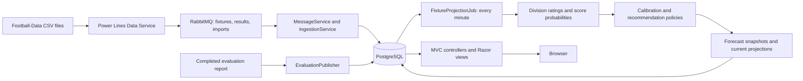
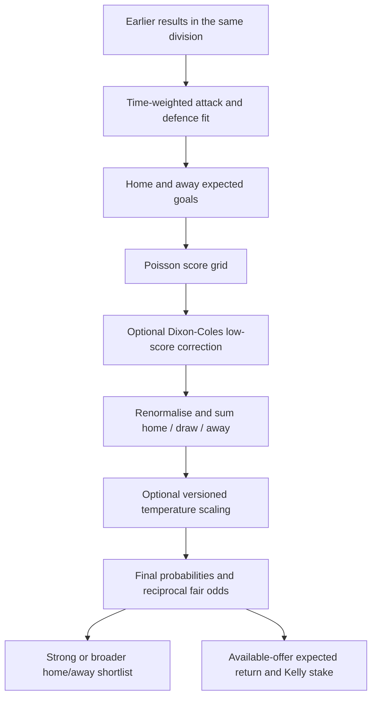
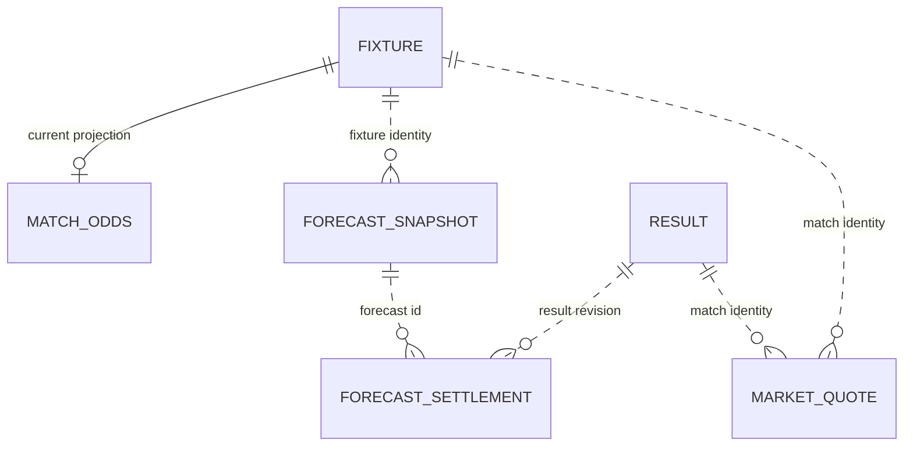

[](https://github.com/johnwatson484/power-lines-web/actions/workflows/build.yaml)

# Power Lines Web

An ASP.NET Core 10 MVC app that consumes football fixtures/results from RabbitMQ, stores them in PostgreSQL, fits goals models and serves fixture forecasts and published evaluation reports. [Power Lines Data Service](https://github.com/johnwatson484/power-lines-data-service) supplies Football-Data imports; this repo owns persistence, forecasting and the web UI.

## How the repos work together



- At startup, `Program.cs` applies Entity Framework Core migrations before running the host. PostgreSQL must be reachable even with workers disabled.
- `MessageService` subscribes to the configured fixture/result fanout exchanges and the fixed `imports` exchange (`imports-web` subscription). `IngestionService` validates and upserts matches, tracks revisions and archives price observations. Repeated imports preserve stable identities; conflicting identities require explicit resolution.
- `FixtureAnalysisBackgroundService` runs `FixtureProjectionJob` immediately and every minute. The job checks kickoff time, result freshness and history support, then saves append-only forecast evidence alongside the latest `MatchOdds` projection. An input/configuration/quote fingerprint avoids repeating unchanged analysis. Matching completed results create settlement records.
- `/` serves the home page; `/Fixtures` reads current forecasts and feed/price status; `/Accuracy` reads the latest completed evaluation report. Live workers do not run historical experiments or regenerate the accuracy report.

## Forecasting models

The implementation is in [Analysis](PowerLinesWeb/Analysis), with fitted ratings in [Analysis/Ratings](PowerLinesWeb/Analysis/Ratings).



The default model is a Maher/Dixon-Coles goals model. `RatingsFitter` fits attack, defence and a division-wide home advantage by coordinate ascent on the weighted Poisson likelihood, then fits a bounded low-score correlation. Older matches receive exponentially smaller weights (`HalfLifeDays`), and a `PriorMatches` prior pulls sparse ratings towards the division average.

Expected goals are:

```text
home = divisionAverageGoals × homeAttack × awayDefence × homeAdvantage
away = divisionAverageGoals × awayAttack × homeDefence
```

Poisson probabilities form a score grid from zero to `MaxGoals` per side. The Dixon-Coles adjustment affects 0–0, 0–1, 1–0 and 1–1. The truncated grid is renormalised, and summing by result produces home/draw/away probabilities. Fair decimal odds are the reciprocal of each final probability. Expected goals and modal goal counts are also exposed.

| Model option/variant | Behavior |
| --- | --- |
| `UseRho=true` (default) | Apply fitted Dixon-Coles low-score correlation. `false` uses independent Poisson probabilities. |
| `HistoryStrategy=LegacyVenue` (default) | Require at least `MinTeamMatches` home appearances for the home team and away appearances for the away team in the division. |
| `HistoryStrategy=TotalHistory` | Require at least `MinTeamMatches` total appearances per team, regardless of venue. |
| `EnableCalibration=false` (default) | Publish raw probabilities unchanged. When enabled, apply an activated temperature artifact matching the model fingerprint, fitted no later than the forecast cutoff from `EarlierRawOutOfFold` examples. With no eligible artifact, use identity scaling. |

Ratings use results inside `YearsToAnalyse`, played strictly before the information cutoff's calendar date, and created/updated no later than that cutoff. Live forecasts use the current information time. `TemperatureScaling.Fit` supports fitting a temperature from earlier raw out-of-fold examples; the web workers do not train or activate calibration artifacts automatically.

### Recommendations and prices

`RecommendationPolicy.Win` shortlists a unique home or away favorite only when it exceeds the draw probability and has sufficient history support. A probability at least `Threshold__Higher` is **Strong**; one at least `Threshold__Lower` is **Broader**. `X` means no selection. Draws remain part of the probability distribution but are not shortlist selections.

Price recommendations also consider home/away outcomes only. They require a fresh, verified `AvailableOffer` with source, revision, observation time and availability. The policy computes commission-adjusted expected return (`probability × net decimal price − 1`), requires it to exceed `MinExpectedReturn`, and selects the highest eligible return. Stakes use fractional Kelly capped by `MaxStakeFraction`; equal returns abstain. De-margined market probabilities provide a disagreement diagnostic, not the selection threshold.

Imported Football-Data averages/closing/max/bookmaker columns are indicative observations with unknown quote times. Ingestion archives them with `Available=false`; they do not qualify as available offers. `Betting__MinEdge` is retained in configuration/fingerprints but does not gate the current price policy.

### Forecast availability and accuracy

`Feed__FixtureTimeZoneId` defaults to `Europe/London`, matching the confirmed UK kickoff clock in the Football-Data feed. Override it if the source changes its timezone contract. Missing times, invalid/ambiguous local times or an unset timezone produce “Kickoff time or timezone unverified” rather than a live forecast. Stale result history and insufficient team support also suppress forecasts. Feed freshness checks remain internal; the public fixtures page omits source and import diagnostics. The fixtures page opens on today in the feed timezone, with day buttons and forecast filters applied together. Unavailable forecasts show the reason in place of probabilities and fair odds; supported forecasts show all three outcome probabilities and their reciprocal fair odds.

Accuracy publication uses `EvaluationPublisher`: it accepts completed report JSON only when its SHA-256 fingerprint matches, and stores dataset/manifest/code versions and the test period. `/Accuracy` displays coverage, log loss and Brier score from the latest completed report; lower scoring-rule values are better. A fresh database shows an empty accuracy page until a report is published. This repo contains the publication service, not a bundled evaluator CLI or HTTP publication endpoint.

## Stored and view models

Persistent entities are in [Data](PowerLinesWeb/Data) and [Forecasts/Records.cs](PowerLinesWeb/Forecasts/Records.cs). MVC view models are in [Models](PowerLinesWeb/Models).



Only the fixture-to-odds link is an EF relationship here; dotted links describe the IDs/identity strings used by application code.

| Entity/table | Purpose |
| --- | --- |
| `Data.Fixture` / `fixtures` | Scheduled matches, source provenance, prices, lifecycle/analysis status and revision. |
| `Data.Result` / `results` | Full-time outcome, optional half-time observations, source metadata, row revision and separate score revision. |
| `Data.MatchOdds` / `match_odds` | Mutable latest fixture probabilities, fair odds, expected/modal goals and shortlist/price decisions. |
| `ImportStatus` / `import_statuses` | Completed source imports and row counts used for feed status. |
| `MarketQuote` / `market_quotes` | Append-only source/price revisions, observation/ingestion times, availability and commission. |
| `ForecastSnapshot` / `forecast_snapshots` | Append-only raw/final probabilities, cutoff, model/input/calibration/policy versions and decision provenance. |
| `ForecastSettlement` / `forecast_settlements` | Append-only links between a forecast and each settled result revision. |
| `CalibrationArtifact` / `calibration_artifacts` | Append-only versioned temperatures, training provenance and activation state. |
| `EvaluationRun` / `evaluation_runs` | Versioned report JSON and test period; completed reports are immutable. |
| `Models.Fixture`, `FixturePage`, `DivisionFeedStatus` | Presentation models combining forecasts, market observations, support and feed status. |
| `AccuracyPage`, `EvaluationCandidateSummary` | Presentation models for a completed report's candidate coverage and scores. |

`AnalysisFixture`, `TeamRatings`/`TeamRating`, `MatchProbabilities`, `GoalDistribution` and `AnalysisMatchOdds` are in-memory analysis models. `IncomingPrice` carries original source price columns during ingestion. The historical `accuracy`, `accuracy_calibration` and `result_match_odds` tables are removed by migrations; current reporting uses evaluation runs and snapshots.

## Dependencies

- .NET 10 SDK (selected by `global.json`).
- Docker Engine/Desktop with Compose 2.24+ for dependency containers and Testcontainers integration tests.
- Bash for scripts and VS Code terminal tasks (use WSL on Windows), and the VS Code C# extension for debugging.
- Registry/NuGet access for builds. Development dependencies remain `postgres:11.4-alpine` and `rabbitmq:3-management-alpine`; this change does not upgrade persisted databases.

## Run in development

Native execution is the default. From this repo:

```sh
cp .env.example .env
dotnet restore
./scripts/local
```

This starts PostgreSQL and RabbitMQ, waits for their health checks, then runs web with `dotnet watch`. Startup applies EF migrations. To manage dependencies and the app separately:

```sh
./scripts/services-up
./scripts/dev
# Or run once without watching:
dotnet run --project PowerLinesWeb
```

| Service | Host address | Development credentials |
| --- | --- | --- |
| Web | `http://localhost:5000` | No login |
| RabbitMQ AMQP | `localhost:5672` | `rabbitmq` / `rabbitmq` |
| RabbitMQ management | `http://localhost:15672` | `rabbitmq` / `rabbitmq` |
| PostgreSQL | `localhost:6000`, database `power_lines_web` | `postgres` / `postgres` |

The example `.env` supplies the native database connection on port `6000`. Update both the connection string and Compose `POSTGRES_*` values when changing database credentials/ports. Set `Workers__Enabled=false` for a read-only UI; startup migrations still require PostgreSQL.

VS Code provides **Local**, **Dev**, dependency, build, test, watch and Docker tasks. **Dev: native** launches the local C# debugger; start dependencies first. **Docker: Attach** remains available for the optional web development container.

### Run the app in Docker

```sh
docker compose --profile app up -d --build power-lines-web
docker compose logs -f power-lines-web
# Stop the Docker app before using native port 5000 again:
docker compose --profile app stop power-lines-web
```

Without `--profile app`, Compose starts dependencies only. The development app uses `dotnet watch`; PostgreSQL is `power-lines-web-postgres:5432` and RabbitMQ is `power-lines-message:5672` inside the network.

### Import from the companion repo

With web consumers running and sibling clones:

```sh
cd ../power-lines-data-service
cp -n .env.example .env
./scripts/local --results --all
./scripts/run-service --fixtures
# Optional Docker execution of the one-shot importer:
./scripts/run-service --docker --fixtures
```

### Shared RabbitMQ and standalone use

Each app repo defines the same `power-lines-message` service in Compose project `power-lines`, on network `power-lines`. Either repo can start independently; starting the other sequentially reuses the broker. Keep `Message__Username`, `Message__Password`, `Message__Port` and `RABBITMQ_MANAGEMENT_PORT` identical in both `.env` files. Container apps use the broker's internal hostname and port automatically. The `fixtures`, `results` and `imports` fanout exchanges are unchanged.

Use [Power Lines Core](https://github.com/johnwatson484/power-lines-core) for sibling clones and the VS Code workspace. Core calls each repo's startup commands sequentially and owns no dependencies. Start web and wait for its “Consuming fixtures, results and import statuses” log before importing, so subscription queues exist. Import results before fixtures when building forecasting history.

`./scripts/services-down` stops this repo's dependency containers, including shared RabbitMQ, and affects both apps. It retains containers, the shared network and stored data. Stop native apps with Ctrl+C or terminate their VS Code tasks. Do not use `--remove-orphans`: the other repo's services belong to the same project. Web's `power-lines_postgres_data` volume is retained; remove it only when deliberately resetting development data.

### Production image

```sh
docker build --target production -t power-lines-web .
docker run --rm -p 5000:5000 --env-file /path/to/web.env power-lines-web
```

Provide reachable PostgreSQL/RabbitMQ connection settings in `web.env`. The runtime image runs the compiled DLL as a non-root user, listens on port 5000 and includes timezone/globalization data. Terminate HTTPS through the deployment's proxy. Local `.env` files are excluded from images and published output.

## Environment variables and defaults

.NET maps `__` to nested keys, case-insensitively: `Model__MaxGoals` and `MODEL__MAXGOALS` both bind to `Model:MaxGoals`. Environment settings override `appsettings.json` and optional `appsettings.{Environment}.json`; command-line configuration has higher precedence. The tables show effective checked-in app defaults. The app loads the optional repository-root `.env` before building its host, from either the repo root or app project directory. Existing environment variables win over `.env`; command-line configuration wins over both. No parent-directory search is performed. Compose reads `.env` for interpolation and passes it to the profiled app through `env_file`, with explicit internal-host overrides.

### Connections and hosting

| Environment variable | Default | Purpose / development override |
| --- | --- | --- |
| `ConnectionStrings__PowerLinesWeb` | `Server=localhost;Port=5432;Database=power_lines_web;User Id=postgres;Password=postgres;` | PostgreSQL connection. Compose changes host to `power-lines-web-postgres`; a host process using Compose PostgreSQL needs port `6000`. |
| `Message__Host` | `localhost` | Compose sets `power-lines-message`. |
| `Message__Port` | `5672` | AMQP port. |
| `Message__Username` | `rabbitmq` | Broker username. |
| `Message__Password` | `rabbitmq` | Broker password. |
| `Message__FixtureQueue` | `fixtures` | Fixture fanout exchange; match the importer. |
| `Message__FixtureSubscription` | `fixtures-web` | Fixture consumer subscription queue. |
| `Message__ResultQueue` | `results` | Result fanout exchange; match the importer. |
| `Message__ResultSubscription` | `results-web` | Result consumer subscription queue. |
| `Workers__Enabled` | `true` | Enable RabbitMQ consumers and the one-minute fixture analysis worker. |
| `AllowedHosts` | `*` | ASP.NET Core host filtering. |
| `ASPNETCORE_ENVIRONMENT` | `Production` when unset | Dockerfiles set `DOTNET_ENVIRONMENT=Development` / `Production`; selects environment-specific settings and error handling. |
| `DOTNET_ENVIRONMENT` | Unset | Also selects the web host environment; takes precedence over `ASPNETCORE_ENVIRONMENT` with `WebApplication.CreateBuilder`. |
| `ASPNETCORE_URLS` | No repo override for local CLI; framework default is `http://localhost:5000` | Both image stages explicitly set `http://*:5000`. |

The `imports` exchange and `imports-web` subscription are fixed in code. The Docker app listens on port 5000 through `ASPNETCORE_URLS`; native `.env.example` uses `http://localhost:5000`.

### Goals model

| Environment variable | Default | Meaning |
| --- | --- | --- |
| `Model__Version` | `goals-corrected-v1` | Version label included with the full options fingerprint. |
| `Model__HistoryStrategy` | `LegacyVenue` | Venue-specific support; `TotalHistory` uses total appearances. |
| `Model__UseRho` | `true` | Apply fitted Dixon-Coles correction. |
| `Model__EnableCalibration` | `false` | Use an eligible activated temperature artifact if available. |
| `Model__MaxGoals` | `10` | Maximum goals per side in the renormalised score grid. |
| `Model__MinTeamMatches` | `10` | Minimum history for each team under the chosen strategy. |
| `Model__YearsToAnalyse` | `6` | Training-history lookback in years. |
| `Model__BacktestYears` | `3` | Lookback used by the manual half-life diagnostic; does not schedule report generation. |
| `Model__MaxOdds` | `1000` | Zero-probability fallback in the odds calculator; positive fair odds use exact reciprocals. |
| `Model__HalfLifeDays` | `365` | Exponential weighting half-life; `0` disables decay. |
| `Model__PriorMatches` | `5` | Prior strength pulling ratings towards the league average. |
| `Model__MaxIterations` | `100` | Maximum coordinate-ascent iterations. |
| `Model__Tolerance` | `0.000001` | Fit/search convergence tolerance. |
| `Model__MinCalibrationPredictions` | `30` | Retained only in serialized fingerprints; no longer controls calibration. |

### Recommendation policy

| Environment variable | Default | Meaning |
| --- | --- | --- |
| `Threshold__Version` | `win-v1-conservative` | Shortlist policy version label. |
| `Threshold__Higher` | `0.70` | Inclusive Strong probability threshold. |
| `Threshold__Lower` | `0.65` | Inclusive Broader probability threshold. |
| `Betting__MinExpectedReturn` | `0` | Strict minimum commission-adjusted expected return for an available offer. |
| `Betting__MinEdge` | `0.08` | Legacy configuration/fingerprint value; current policy reports disagreement but does not gate on this value. The class initializer alone is `0.05`; appsettings overrides it to `0.08`. |
| `Betting__KellyFraction` | `0.25` | Fraction of full Kelly stake. |
| `Betting__MaxStakeFraction` | `0.05` | Maximum fraction of bankroll for a selection. |
| `Betting__MinOdds` | `1.2` | Minimum eligible decimal offer price. |
| `Betting__MaxOdds` | `10` | Maximum eligible decimal offer price. |
| `Betting__MaxQuoteAgeMinutes` | `30` | Maximum age of an observed available offer. |

Policy validation requires `0.5 <= Lower <= Higher <= 1`, nonnegative minimum expected return, Kelly/stake fractions in `(0, 1]`, `MinOdds > 1`, `MaxOdds >= MinOdds` and positive quote age.

### Feed and logging

| Environment variable | Default | Meaning |
| --- | --- | --- |
| `Feed__FixtureTimeZoneId` | `Europe/London` | Verified source kickoff timezone; required for live prematch forecasts. |
| `Feed__MaxResultAgeDaysInSeason` | `21` | Result freshness threshold; also suppresses analysis outside season-break months. |
| `Feed__SeasonBreakMonths__0` | `6` | First month exempt from in-season result-age checks. |
| `Feed__SeasonBreakMonths__1` | `7` | Second exempt month. |
| `Feed__SeasonBreakMonths__2` | `8` | Third exempt month. Array entries bind by numeric index. |
| `Logging__LogLevel__Default` | `Information` | Default log level. |
| `Logging__LogLevel__Microsoft` | `Warning` | Microsoft category level. |
| `Logging__LogLevel__Microsoft.Hosting.Lifetime` | `Information` | Host lifecycle level. |
| `Logging__LogLevel__Npgsql.EntityFrameworkCore.PostgreSQL` | `Critical` | Npgsql EF category level. |
| `Logging__LogLevel__Microsoft.EntityFrameworkCore` | `Critical` | EF category level. |

Logging category names containing dots require an env-file entry, Compose mapping or `env 'Logging__LogLevel__Microsoft.EntityFrameworkCore=Information' ...`, rather than a normal shell assignment.

Compose configures RabbitMQ credentials from `Message__Username`/`Message__Password`. PostgreSQL uses `POSTGRES_DB`, `POSTGRES_USER` and `POSTGRES_PASSWORD`. These dependency settings must agree with the native app connection string.

## Test and CI

```sh
dotnet test --configuration Release --collect:"XPlat Code Coverage"
# Fast unit-only run, without Docker:
dotnet test --filter 'TestCategory!=Integration'
# Integration only:
dotnet test --filter 'TestCategory=Integration'
```

The native NUnit suite includes PostgreSQL migration, persistence and ingestion-concurrency tests plus RabbitMQ acknowledgement/recovery tests. Testcontainers starts disposable dependencies on dynamically assigned ports and cleans them up. Tests do not read development `.env` files or use manually supplied database/broker addresses. Docker must be reachable for integration tests; startup failures fail the run rather than silently skipping it. Unit-only runs start no containers.

Both projects write outputs to repository-level `bin/` and `obj/`. Coverage and TRX files are uploaded by the reusable native-checks workflow on PRs and before the `main` image-publishing/release/deployment workflow. PRs need no deployment secrets.

The optional `[Explicit]` `HalfLifeDaysSweepTests` diagnostic remains manual, reads historical results on `localhost:6000/power_lines_web` and is excluded from ordinary CI. It is not the evaluator that publishes completed reports.
